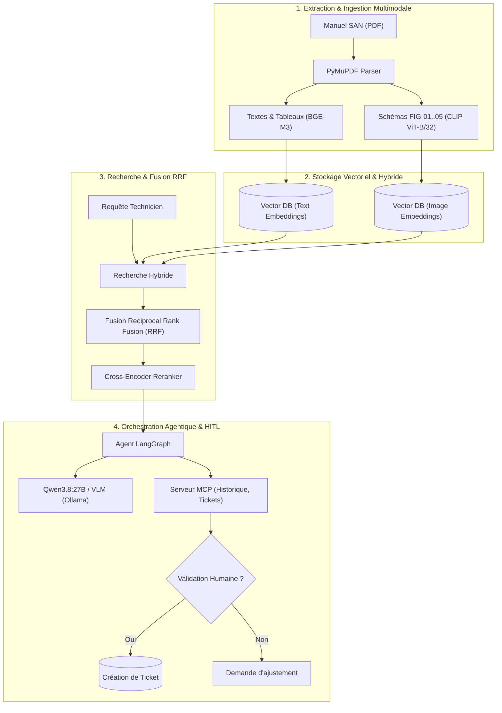

# 🗂️ MaintiDoc SAN — Assistant Agentique Multimodal de Maintenance

[](https://www.python.org/)
[](https://www.docker.com/)
[](https://ollama.com/)
[](https://www.llamaindex.ai/)
[](https://www.langchain.com/langgraph)

**MaintiDoc** est une plateforme d'assistance à la maintenance industrielle pour les baies de stockage SAN (*Storage Area Network*).  
Le système passe d'un prototype de RAG multimodal local à une solution **agentique complète**, sécurisée, vérifiable (zéro hallucination avec citations strictes de pages et schémas) et intégrée au système d'information via le protocole standardisé **MCP** (*Model Context Protocol*).

---

## 🎯 Objectifs Métier & Fonctionnels

- **Zéro Décision Aveugle** : Chaque recommandation technique s'appuie obligatoirement sur une preuve traçable (numéro de page, identifiant d'élément, hachage SHA-256 du document, coordonnées de figures).
- **Multimodalité Réelle** : Traitement conjoint du texte technique, des tableaux de diagnostic de pannes et des schémas électroniques/architecturaux (`FIG-01` à `FIG-05`).
- **Orchestration Agentique Sécurisée** : Graphe d'état avec gestion des demandes de clarification et garde-fous.
- **Human-in-the-Loop** : Création d'actions engageantes (tickets de maintenance, commande de pièces) conditionnée à une approbation explicite de l'opérateur humain.

---

## 🏗️ Architecture Technique



---

## 📁 Structure du Projet

```text
├── AGENT.md                 # Charte de travail & Rôle du Technical Lead (LLMography)
├── SPRINTS.md               # Feuille de route opérationnelle (7 Sprints)
├── README.md                # Documentation générale du projet
├── docker-compose.yml       # Stack conteneurisée (Ollama + Workspace)
├── Dockerfile               # Image applicative avec Python 3.12 et uv
├── .dockerignore            # Exclusions de build Docker
├── pyproject.toml           # Dépendances déclarées du projet
├── Manuel_Maintenance_SAN_Projet_Integrateur.pdf  # Document source
├── MaintiDoc_SAN_Qwen3_8_JSON_c.ipynb            # Notebook expérimental initial
└── app.py                   # Prototype Streamlit initial
```

---

## 🚀 Démarrage Rapide (Stack Docker)

Le projet s'exécute entièrement dans des conteneurs isolés gérés par Docker Compose :

### 1. Cloner le dépôt et lancer les services
```bash
# Lancement d'Ollama et du Workspace applicatif
docker compose up -d
```

### 2. Télécharger le modèle dans le conteneur Ollama
```bash
docker exec -it maintidoc-ollama ollama pull qwen3.8:27b
```

### 3. Accéder aux interfaces
- **JupyterLab / Workspace** : [http://localhost:8888](http://localhost:8888)
- **API Ollama** : [http://localhost:11434](http://localhost:11434)

---

## 🗺️ Feuille de Route des Sprints

Consultez [`SPRINTS.md`](file:///c:/Users/riyad/OneDrive/Desktop/UNIVERSITE%20S9/EMSI/IA%20GENERATIVE%20TEXTUELLE/MaintiDoc_SAN/MaintiDoc_SAN_AYOGNIDE/SPRINTS.md) pour le détail des jalons :
1. **Sprint 1** : Industrialiser le stockage vectoriel (PGVector / Qdrant)
2. **Sprint 2** : Améliorer la recherche (Recherche hybride & Reranking)
3. **Sprint 3** : Orchestration agentique avec LangGraph
4. **Sprint 4** : Connecteur MCP & Human-in-the-Loop
5. **Sprint 5** : Sécurité et Gouvernance (RBAC, Audit, Prompt Injection)
6. **Sprint 6** : Évaluation quantitative & Observabilité MLflow
7. **Sprint 7** : Déploiement final et interface client

---

## 🛡️ Règle Système & Gouvernance
Pour comprendre la posture technique, la méthodologie de développement pas-à-pas et retrouver l'historique des prompts structurants, référez-vous au fichier [`AGENT.md`](file:///c:/Users/riyad/OneDrive/Desktop/UNIVERSITE%20S9/EMSI/IA%20GENERATIVE%20TEXTUELLE/MaintiDoc_SAN/MaintiDoc_SAN_AYOGNIDE/AGENT.md).

